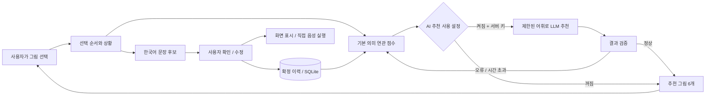

# 제안서와 구현 대응

원안: [Capstone Design – AAC](https://docs.google.com/document/d/1OREAwXGHU4B_dt4vumBLO0tI30KbPHGEbdKrIRYUg6g/edit?tab=t.0), 2026-10-16 확인. 팀원의 개인정보는 저장소에 복사하지 않았습니다.

| 제안서 항목 | 구현 | 주요 파일 |
| --- | --- | --- |
| Adaptive Symbol Selection Interface | 6개 추천 그림, 분류 탐색, 전체 어휘 | `web/app.js`, `web/index.html` |
| Context-Aware Next-Symbol Recommendation | 현재 선택 + 상황 + 확정 이력, 선택적 LLM | `aac/prediction.py`, `aac/llm.py` |
| User Intent Tracking | 순서 있는 선택 상태, 개별 삭제·되돌리기, 오래된 비동기 응답 무시 | `web/app.js` |
| Restricted Vocabulary Recommendation | 47개 ID 열거형과 서버 재검증 | `aac/vocabulary.py`, `aac/prediction.py` |
| Sentence Generation | 한국어 조사/부정/추가 요청, 제약된 후보 선택, 사용자 편집 | `aac/sentences.py` |
| Text and Speech Output | 큰 글자 출력, 명시적 TTS 실행·중지 | `web/app.js` |
| Recommendation Refresh | 기존 문맥 유지, 직전 추천 제외, 전체 순회 후 처음으로 | `aac/prediction.py`, `web/app.js` |
| Personalized Prediction | 확정된 그림 순서와 빈도 기반 개인화, 프로필별 분리 | `aac/storage.py` |
| Prompt-Based Alignment | 제한 어휘·사용자 주도·문맥 데이터를 구분하는 프롬프트 | `aac/llm.py` |
| Fine-Tuning | JSONL 준비·개인정보 축소·평가 계획; 실제 학습 미실행 | `scripts/prepare_training.py` |
| Evaluation | 고정 그림판, 실제 상호작용 집계, 합성 시뮬레이션 | `scripts/evaluate.py` |

## 데이터 흐름

기본 추천은 의미 태그 연관 점수, 최근 선택 위치, 확정 이력 100건 내 빈도/동일 접두 시퀀스, 사용자가 고른 상황을 합산합니다. 고정된 어휘 순서를 동점 기준으로 사용합니다. UI 순서가 요청마다 무작위로 바뀌지 않습니다. 이 규칙 추천은 학습된 언어모델로 표기하지 않습니다.

문장 후보는 의미 확장을 제한하기 위해 규칙 기반입니다. `eat + bread + not`는 `빵을 먹고 싶지 않아요.`로 처리합니다. 여러 행동처럼 문법적으로 모호한 조합은 각 선택 라벨을 모두 보존하고 직접 편집할 수 있도록 합니다. LLM은 만들어진 후보를 선택하므로 자유로운 문장 생성은 현재 구현 범위에 포함되지 않습니다.

## API

모든 POST 요청은 `Content-Type: application/json`을 사용합니다. 초기 정보와 프로필 생성을 제외한 요청에는 `X-Profile-ID` 헤더가 필요합니다. 응답은 UTF-8 JSON입니다.

| Method | 경로 | 입력 / 결과 |
| --- | --- | --- |
| GET | `/api/bootstrap` | 어휘, 분류, 서버 LLM 연결 가능 여부 |
| POST | `/api/profiles` | `{name}` → 로컬 프로필 ID |
| GET / POST | `/api/profile` | 이름 / `cloud_enabled` 설정 |
| POST | `/api/recommend` | `{selected, category?, context?, excluded?}` → `symbols`, `source`, `remaining` |
| POST | `/api/sentence` | `{selected}` → `sentence`, `alternatives`, `source` |
| POST | `/api/confirm` | `{id, selected, sentence, mode, context, selection_count, elapsed_ms}` → 저장 결과 |
| GET | `/api/history` | 최근 100개 메시지와 모드별 전체 집계 |
| GET | `/api/export` | 최대 10,000개 메시지, 직접 쓴 문장 포함, 프로필 ID 제외 |
| POST | `/api/history/clear` | 현재 프로필의 저장 이력 삭제 |

`context`: `any`, `home`, `school`, `meal`. `mode`: `adaptive`, `static`. `source`: `local`, `llm`, `fallback`. 선택 그림은 중복 없이 최대 12개, 확정 문장은 최대 300자입니다. 생성과 추천은 이력을 저장하지 않습니다. 메시지 UUID는 재시도 시 중복 저장을 방지합니다.

## 로컬 데이터 경계

- 앱은 loopback 주소에만 바인딩하고 Host·Origin을 확인합니다. 다른 웹사이트에서의 사용 기록 읽기/쓰기를 차단합니다.
- 정적 자산은 명시된 네 파일만 서빙합니다. `.env`, DB, 저장소 파일을 웹으로 노출하지 않습니다.
- 프로필 ID는 로컬 브라우저의 bearer token처럼 사용됩니다. 프로덕션 인증 체계는 아닙니다.
- SQL은 매개변수화하고 사용자 문자열은 DOM의 `textContent`/`value`로 표시합니다.
- LLM 연결 실패는 규칙 추천으로 돌아갑니다. API 서버 연결이 끊겼을 때 이미 불러온 전체 어휘는 탐색할 수 있지만 문장 생성/저장은 서버가 필요합니다.
- 요청 본문 20KB, 모델 응답 128KB, 공급자 호출 8초, 브라우저 요청 12초로 제한합니다.
- 사용 기록·키·생성물은 Git에서 제외합니다. 데이터 이동과 학습 제출은 사용자 작업으로 남겨 둡니다.
